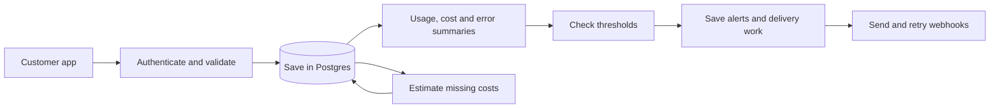

# Backend plan

Build `apps/api` first: accept usage events, save them safely, and return useful summaries. Pricing, alerts, and webhooks follow that working path.

The API currently has only `/health`. This plan and the [database schema](database-schema.md) are proposals. Credential lifetime is settled in the [product specification](../specification.md#authentication-privacy-and-records).

## Main decisions

| Part                   | Choice                                            | Why                                                  |
| ---------------------- | ------------------------------------------------- | ---------------------------------------------------- |
| HTTP                   | Existing Express + Zod                            | Already set up; validates incoming data              |
| Database               | Neon PostgreSQL                                   | Transactions and unique keys protect accounting      |
| Queries and migrations | Drizzle + `pg`                                    | Typed tables with interactive transactions           |
| Summaries              | SQL over saved events                             | Totals can be checked against the original data      |
| Background work        | A separate process from the same backend codebase | Pricing and slow webhooks should not delay ingestion |

Drizzle supports this Node.js setup; see its [Neon connection guide](https://orm.drizzle.team/docs/connect-neon). Another managed PostgreSQL would also work. Revisit hosting or aggregation only when measured cost or performance requires it.

Start with `apps/api`, `packages/db`, and `packages/contracts`. Keep backend features inside the API app until another app needs to share their logic.

## Overall flow



The customer still calls providers directly. Relay receives usage records afterward.

## Ingestion keys

Use a credential containing a public key UUID and a random secret:

```text
relay_<key_uuid>.<random_secret>
```

The UUID finds the database row. Hash the submitted secret and compare it with the saved hash, then check revocation. Do this once per HTTP request, including a request containing several events. The key's database row determines the project.

Each project has at most one active key. Regeneration replaces it atomically, so the old credential stops working when the new one becomes active.

Recommend these opaque keys for ingestion. JWTs can avoid a database lookup when checked offline, but immediate individual revocation requires checking current server-side state anyway. That advantage does not help this flow. See [RFC 7009](https://www.rfc-editor.org/rfc/rfc7009.html#section-3).

The [schema](database-schema.md#ingestion-keys) explains storage and regeneration. User login is separate from ingestion authentication.

## Saving a batch

1. Check the credential and validate the events. Limit request size and batch length; initial proposals are 256 KiB and 100 events.
2. Normalize timestamps, decimal strings, and measurement order. Identical copies of an ID inside the batch collapse; conflicting copies reject it.
3. In one transaction, recheck revocation and save new events, their measurements, and initial costs. Insert in event-ID order to reduce deadlocks.
4. The database enforces one event per `(project_id, event_id)`. If another request already saved that ID, compare the original normalized client content in a subsequent SQL statement: identical means duplicate, changed means `409`.
5. Any invalid/conflicting event rejects the whole batch. Reply only after commit, listing saved and duplicate IDs.

The credential check and revocation must coordinate through row locks so a key cannot continue submitting after revocation commits. A database error produces an explicit failure, never a saved acknowledgement.

```text
Event A costs $10 → upload succeeds, response is lost
Retry the same A → acknowledge duplicate → total remains $10
Retry A with a changed cost → 409 → stored A stays unchanged
```

Store accepted events unchanged. Derived costs and server receipt times are not part of duplicate comparison. If an age limit is added for new events, it must not invalidate identical retries of retained events.

The event contract still needs finalization. It must include optional supplied cost (`reportedCost`) and a safe attribution label (`keyLabel`); the current recording sketches do not settle those fields. Collect only approved provider details, never provider secrets or request/response bodies.

## Cost and summaries

Each event has one current cost row. Supplied cost takes precedence. Otherwise, save pending cost and estimate it later from stored prices effective at event start time. Missing usage or pricing produces unknown cost, not zero. Preserve the selected pricing/formula version; new prices do not silently change old estimates.

Use exact decimals for money. Keep currencies separate until conversion rules are agreed. An event with two measurements still counts as one call and contributes its cost once; aggregate measurements separately from event counts and costs.

Summaries use event start time in UTC: include the start of a window and exclude its end. Return known cost with pending/unknown/error counts. Zero calls has no measured error rate. Use one consistent database snapshot for a response containing several queries.

See the [cost and summary design](../features/event-recording/architecture.md#5-calculating-cost) for the detailed accounting rules.

## Rules and webhooks

Proposed first rule: provider cost greater than a threshold in one currency over the last 24 hours, checked every minute.

Create one alert when the condition first becomes true. Do not repeat it while it stays true. Reset only when the subtotal is below or equal to the threshold and no unresolved costs could change that result. Known amounts in other currencies are excluded and disclosed; they do not block reset. Scheduled checks can miss brief crossings or crossings during downtime.

Save rule state, the alert, and its delivery work in one transaction. The sender claims saved work, releases database locks, sends HTTP, then records the attempt. Use bounded retries and recover expired claims after a crash. A stale sender cannot overwrite a newer claim's result.

If the customer receives a webhook but Relay crashes before recording success, a retry may deliver it again. Preserve the alert ID and payload so the customer can deduplicate. Automatic retries keep the saved destination; disabling an endpoint cancels pending work, while already claimed sends may finish.

Sign webhook payloads. Validate the actual connection destination on every send, block private/local addresses, and reject redirects. Production dispatch requires the [webhook security design](../features/event-recording/architecture.md#10-protecting-webhook-delivery). Manual replay and signing-key rotation need their lifecycle settled before implementation.

## End-to-end dry runs

These are design walkthroughs, not executed database tests.

| Case                                           | Expected result                                                                 |
| ---------------------------------------------- | ------------------------------------------------------------------------------- |
| Same event uploaded twice or concurrently      | One event and one cost                                                          |
| Same ID with changed content                   | `409`; no new rows from that batch                                              |
| One malformed event in a batch                 | Nothing from the batch is saved                                                 |
| Commit succeeds but reply is lost              | Retrying unchanged IDs is safe                                                  |
| Key revoked or regenerated                     | Old credential fails; recorded history remains                                  |
| Two requests create a key for the same project | Only one active key is saved; the other request gets `409`                      |
| One event has input and output tokens          | One call; quantities stay separate                                              |
| Price missing, or calculation fails            | Usage remains saved; cost shows unknown or processing error                     |
| USD and INR events                             | Separate currency totals                                                        |
| Two workers check the same rule                | One alert for the same trigger episode                                          |
| Worker crashes during delivery                 | Recover saved work; customer may receive a duplicate                            |
| A request targets another project's data       | Authorization rejects it; foreign keys also protect cross-project relationships |

## Backend-first milestones

1. Choose the login provider and project access model. Add users, projects, and ingestion-key creation, revocation, and regeneration.
2. Finalize the event contract. Implement transactional ingestion and prove duplicate handling against real PostgreSQL.
3. Add event listing, summaries, provider/key breakdowns, and time series.
4. Add one provider's pricing and a background pricing process.
5. Add the first rule, alert creation, and durable webhook delivery with attempt history.
6. Build the SDK against the working ingestion API, following its [plan](../features/event-recording/plan.md).

Before coding each milestone, settle only the decisions it needs. Login provider, shared project access, supported currencies, pricing details, and deployment limits remain open. Retention/deletion needs a policy before enabling it. Significant ingestion, accounting, rule, and webhook guarantees need ADRs as described in the [processing design](../features/event-recording/architecture.md#decisions-still-to-settle).
