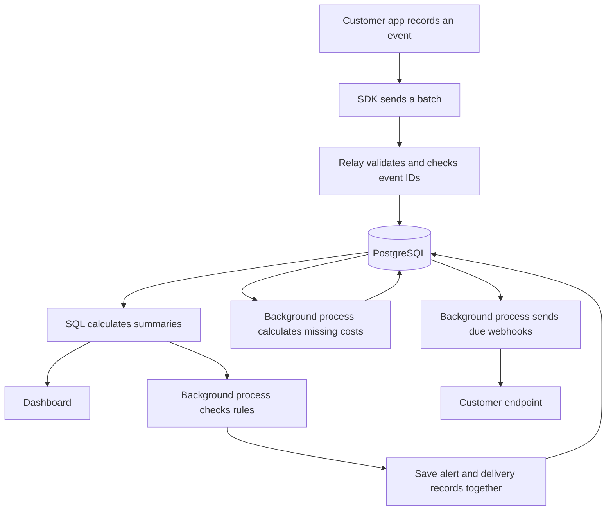
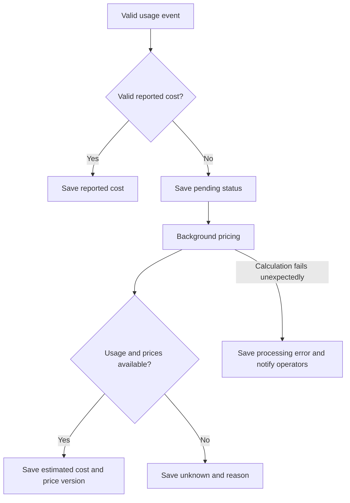
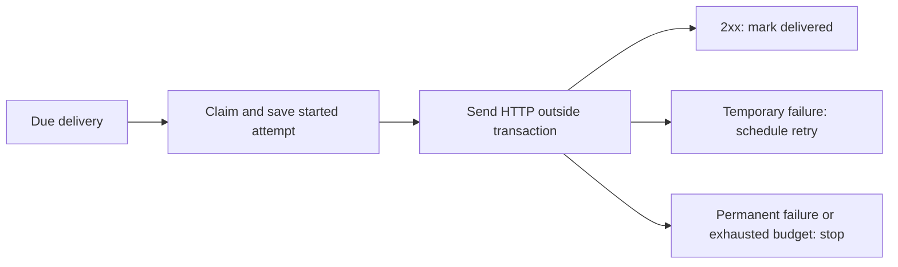

# How Relay processes usage events

## Status

This is a recommended design, not an implemented or approved architecture. It follows [the product specification](../../specification.md) and [the recording specification](spec.md). No existing architecture documents or ADRs were found when this design was first written.

The examples describe proposed behavior. Choices affecting users still need agreement and matching specification updates before implementation. The event format also needs one final versioned HTTP schema; earlier conceptual examples are not separate formats to support through silent fallbacks.

## The whole flow



Recommendation: one TypeScript codebase, PostgreSQL, an HTTP application, and a background process sharing the same database and business logic.

The HTTP application saves events before replying. The background process calculates estimated costs, checks rules, and sends/retries webhooks. Keeping that work outside HTTP requests prevents a slow webhook from delaying ingestion.

These are separate process roles, not separate microservices. No ingestion broker, Redis, Kafka, ClickHouse, or cache is currently needed.

| Proposed location | Responsibility |
| --- | --- |
| `apps/api` | HTTP ingestion, login/access checks, dashboard/configuration APIs |
| `apps/web` | Dashboard and settings UI |
| `apps/worker` | Background pricing, rule checks, webhook delivery |
| `packages/contracts` | Shared event/API validation |
| `packages/db` | Tables, migrations, database access |
| `packages/core` | Pricing/rule functions and shared accounting rules |
| `packages/sdk` | Customer-side capture and upload |

The stack/package layout still needs approval. Do not add generic frameworks just to make every part replaceable.

## 1. Sending events from the SDK

The application should receive the provider's result without waiting for Relay to upload telemetry.

| Option | Trade-off |
| --- | --- |
| Upload after every call and wait | Simple, but Relay availability adds provider-call latency |
| Limited in-memory buffer and HTTPS batches | Keeps calls responsive; a crash can lose unsent events |
| Save events to local disk first | Stronger capture, but adds storage/lifecycle/security work |
| Keep a streaming connection open | Adds connection management without a current requirement |

Recommend limited in-memory buffering and batches sent to versioned `POST /v1/events`. Manual recording and integrations use the same path. Finalize one event per logical invocation. SDK-created IDs stay unchanged during retries; replaying an existing event must preserve its ID. A provider request ID does not replace the Relay event ID. Exclude Relay uploads from instrumentation.

### What record and flush mean

`record` checks and queues an event locally. It does not mean PostgreSQL has saved it.

Recommend rejecting a new event when the buffer is full, keeping existing queued events, and reporting the failure explicitly. Invalid manual input returns a specific error. Integration capture failures go through a separate required diagnostics interface, preserving the provider's result/error. Exact public result/callback types remain to be chosen.

`flush` waits for events that were pending when it started, including in-flight uploads. Events recorded later do not keep extending that wait. It succeeds only when those events have been acknowledged as saved, or reports rejected events, exhausted retries, or a deadline failure. Retained failures must remain bounded and identifiable. Shutdown must not wait forever.

Retry network errors, timeouts, 429, and transient server failures with bounded backoff/jitter and an overall deadline. Honor Retry-After only within those limits. Do not repeatedly resend unchanged invalid events, ID conflicts, or invalid credentials. Oversized batches can be split without changing event IDs. Buffer sizes, batch limits, timeouts, and retry limits need concrete values before coding.

```text
Provider succeeds → application receives success
                 → Relay upload fails → separate delivery diagnostic
```

**Limits:** process crashes can lose buffered events. Retries help but do not promise lossless capture. Different IDs for the same provider call cannot be detected as duplicates by the backend.

**Reconsider when:** upload overhead is measured to be too high, or durable customer-side capture becomes required.

**ADR:** yes, for SDK delivery, buffer-full, and flush behavior.

## 2. Checking credentials and incoming data

Options include letting events choose a project, using login sessions for ingestion, or giving each project separate ingestion credentials.

Recommend separate, high-entropy, revocable ingestion credentials. Store a verifier instead of plaintext. The credential determines the project; reject event fields claiming an authoritative project ID. It permits submission, not dashboard reads or settings changes.

Every user-facing read/change still checks project access, including delivery history and replay.

Use a strict versioned schema rather than arbitrary JSON. Set limits for request bytes before parsing, batch size, strings, measurements, decimal precision/range, metadata size/depth, timestamp skew, and project rates/quotas.

Check nonnegative finite quantities/cost/duration, supported currency codes, UTC timestamps, and repeated metric/unit pairs. Unknown providers are allowed; unrestricted metadata is not. Validate provider-specific measurement relationships where they are known.

Make representations consistent without changing meaning: UTC times, canonical decimal strings, stable measurement order, documented identifiers. Do not silently lowercase case-sensitive operations or convert incompatible units. These rules must stay consistent/versioned when comparing duplicate events.

Bound HTTP/database concurrency and database waiting time. Return explicit 429/503 when overloaded instead of accumulating work indefinitely. One API instance can start with local rate limits plus database-backed project quotas. Local limits do not provide a hard total across multiple replicas.

**Example:** an event with a negative token count is rejected; a valid event for an unfamiliar provider is accepted even without pricing.

**Limits:** invalid or unauthorized batches save nothing. Errors identify event index/ID and reason without echoing sensitive data. Validation cannot reliably recognize every secret someone places in an otherwise allowed string; strict fields and careful SDK extraction reduce that risk. Do not log bodies, headers, or credentials.

**Reconsider when:** abuse or multiple API replicas require stronger shared rate enforcement.

**ADR:** no for normal validators/credential mechanics; yes for a major change to project access or trust.

## 3. Saving events and handling repeats

| Option | Trade-off |
| --- | --- |
| Save directly to PostgreSQL before replying | One place to enforce identity and storage guarantees |
| Put events into a queue first | Adds another system and a separate acceptance guarantee |
| Append to a broker and process later | Useful only if a concrete requirement justifies it |

Recommend saving each limited batch in one all-or-nothing transaction. Save the event, measurements, comparable normalized content, and initial cost status together.

`(project_id, event_id)` is unique.

| Incoming event | Result |
| --- | --- |
| New ID | Save it |
| Existing ID, same normalized content | Acknowledge it as a duplicate; do not count again |
| Existing ID, different content | Return 409; save no new events in that batch |

Identical repeats inside one batch collapse; conflicting ones reject the batch. Compare normalized event content, not just a hash. Server timestamps and derived costs are not part of that identity.

Process IDs in consistent order to reduce deadlocks. Database uniqueness handles simultaneous uploads; compare conflicts against the stored committed event. Retry database deadlocks/serialization failures only a bounded number of times; otherwise return an explicit transient failure.

Reply with accepted/duplicate IDs only after commit. Success means **saved**, not priced, checked against rules, or webhook-delivered. Use PostgreSQL's normal durable WAL/commit settings, not asynchronous commits for acknowledged ingestion.

```mermaid
sequenceDiagram
    participant SDK
    participant API as Relay API
    participant DB as PostgreSQL
    SDK->>API: Send evt_123
    API->>DB: Save and commit
    DB-->>API: Committed
    Note over API,SDK: Response is lost
    SDK->>API: Retry evt_123
    API->>DB: Check stored content
    API-->>SDK: Already saved; count once
```

No network pricing lookup runs inside this transaction. No second write to a broker is needed.

**Limits:** a failure before commit saves nothing. A lost response after commit is safe to retry, including the whole batch. One invalid/conflicting event blocks its batch; report all unaccepted items and require correction/removal instead of endless replay. Hardware loss and backup recovery depend on deployment recovery policy; this is not a disaster-proof replication promise.

**Reconsider when:** measured database write limits are reached, or accepting events during database outages becomes a requirement.

**ADR:** yes, for the datastore, acknowledgement, batch, and duplicate-handling guarantees.

## 4. What PostgreSQL stores

Options are JSON-only events, relational event/measurement records, or precomputed totals without original events.

Recommend relational fields for common filtering, separate measurements, and small approved JSON fields for provider-specific information. Preserve accepted events without editing them. Raw events mean validated usage records, not HTTP bodies. Store event start time and Relay receipt time separately.

| Record | What we keep |
| --- | --- |
| Usage event | Project, ID, provider, operation, environment/key, outcome, timing, normalized content |
| Measurement | Event, metric, unit, decimal quantity |
| Event accounting | One active cost record: pending, reported, estimated, unknown, or processing error |
| Pricing version | Effective dates, model/region dimensions, rates, currency, source, formula version |
| Rule and state | Definition revision, scope/window, next check, previous trigger state |
| Alert | Rule version, measured value, window and completeness at trigger time |
| Endpoint | Project-owned destination and protected signing-key references |
| Delivery | Alert/endpoint, fixed payload/destination version, due time, claim and final status |
| Attempt | Attempt number, start/end time, bounded result details, possibly unknown outcome |

Use project-aware foreign keys as well as request checks. Start with an event index on project/time; add provider/key indexes for real query needs. Index pending costs and due deliveries.

Do not multiply event counts or costs by joining an event to several measurements. For example, an event with input and output tokens still contributes one call and one cost.

### Retention

Keep events and IDs initially; do not turn on automatic expiry until history and replay policies are agreed. This is an initial operating choice, not a promise to keep unlimited data.

Deleting an event's ID too early could allow an old retry to be counted again. A future policy must either retain identity records through the allowed replay period or reject events older than that period. Deletion must not silently change promised historical totals.

Backup/restore, backup retention, project deletion, and event-retention duration need explicit policies.

**Limits:** retained events and costs allow totals to be rebuilt. Storage grows and must be monitored.

**Reconsider when:** retention is agreed or measured storage growth requires action.

**ADR:** yes for retention changes affecting history/replay; no for routine columns/indexes.

## 5. Calculating cost

Options are SDK-maintained prices, external lookups during ingestion, recalculation on every dashboard query, or backend calculations saved with each event.

Recommend backend calculations using locally stored pricing versions. Save valid usage first.



Reported cost takes precedence; do not add an estimate on top of it. Save original currency/amount, whether cost was reported/estimated, price/formula version, and calculation time.

Choose prices effective when the event started, including model/region/cache details as needed. Missing usage, dimensions, or price produces unknown with a reason. An unexpected calculation failure is an error, not zero or ordinary missing data.

Use exact decimal arithmetic and PostgreSQL numeric. Define supported precision and rounding before implementation; do not calculate money using JavaScript floating-point arithmetic.

**Example:** if 1,200 input tokens include 300 cached tokens, pricing must separate cached and uncached quantities. Charging for all 1,200 and then adding another charge for 300 would count those tokens twice.

A failed provider call is not automatically free if it has valid billable usage. Storage measurements need their billing duration/meaning before summing them into charges.

New prices do not silently change old costs. Explicit repricing must preserve calculation history, replace the active cost once, and define effects on existing alerts first.

The runner can resume pending rows after a restart. Locks/conditional updates prevent multiple active costs. Unknown rows are not retried endlessly; revisit them explicitly when new prices become available. Calculation errors have bounded attempts and visible operational follow-up.

### Currency

Options are restricting all events to one currency, separate totals by original currency, or automatic conversion.

Recommend original-currency totals until the conversion policy is agreed. Selecting INR must not relabel a USD amount. If conversion is needed but unavailable, an INR aggregate is unavailable.

Cost rules use one explicitly selected source currency and disclose excluded currencies. Reporting currency is not a complete feature until cross-currency behavior is defined.

Decide supported currencies, rate source/date/version, missing-rate behavior, and repricing/alert effects before adding conversion.

**Limits:** known cost can still be incomplete or estimated; show pending/unknown/error counts and cost source. Estimates appear after background calculation. Relay is not verifying provider invoices.

**Reconsider when:** pricing dimensions, currencies, or processing backlog change.

**ADR:** yes for cost authority/versioning and currency conversion; no for individual catalog entries.

## 6. Dashboard totals and time windows

| Option | Trade-off |
| --- | --- |
| SQL over stored events and costs | Simplest; totals follow saved data |
| Update counters during ingestion | Adds concurrent-update and rebuilding concerns |
| Hour/day rollups | Adds another stored result to keep correct |
| Analytical database | Adds infrastructure before a measured need |

Recommend SQL queries using one active cost per event. Dashboard and rule checks use the same calculation rules.

Count logical calls/errors directly. Error rate is errors divided by calls; with no calls, show no rate rather than a measured 0%. Group usage by metric/unit and only sum measurements with known additive meaning. Sum cost by currency and show completeness/source.

Recommend event-start time in UTC. Include the beginning of a window and exclude its end: an event exactly at 11:00 belongs to the next hour, not both hours. Start with UTC hour/day charts. Local calendar budgets need a timezone decision.

```text
Last 24 hours at 15:00: yesterday 15:00 → today 15:00
Today in UTC:          today 00:00 → now
```

Store receipt time to diagnose delays; do not secretly substitute it for event time.

Use one query or a repeatable-read transaction for a multi-query dashboard response so counts, cost, and completeness refer to the same saved data. Include the window and calculation time. PostgreSQL supports this through [transaction isolation](https://www.postgresql.org/docs/current/sql-set-transaction.html).

**Limits:** saved events appear immediately, estimated costs later. Late events or completed pricing can change historical totals. A response does not prove all customer events have arrived. A large query range can be expensive; cap ranges and inspect query plans.

**Reconsider when:** measured query targets cannot be met with suitable indexes.

**ADR:** yes for aggregation/time rules and later rollups or database changes.

## 7. Checking rules

Options are checking every rule inside ingestion, relying on in-memory callbacks, checking due rules on a schedule, or queuing a task for each event.

Recommend scheduled checks by the background process. Save each rule's next check time in PostgreSQL. This works when time passes or prices finish calculating, even without new events.

Proposed first rule: provider cost greater than a threshold over the last 24 hours in one currency. The metric, operator, and window still need agreement.

For each check, lock the rule/state row, capture the database time, and calculate the window total with the shared SQL rules. Save the observed value, completeness, trigger/reset state, next check, alert, and delivery records together.

Other checks and rule edits must coordinate through the same lock and definition revision. Database errors roll back and leave the rule due for another check; report them. A dashboard queried later can show different data without using different accounting rules.

### Avoiding repeated alerts

Recommend one alert when the condition first becomes true, none while it stays true, and another only after it clears and becomes true again. An alert ID is unique for the rule version and trigger episode.

```text
Cost:    $18 → $22 → $25 → $16 → $23
Alert:          yes    no          yes
```

This example assumes complete data and a $20 threshold. Unknown costs change what we can conclude:

| Known subtotal | Missing costs? | Result |
| --- | --- | --- |
| $22 | Yes | Threshold is already exceeded |
| $18 | Yes | Cannot prove it is below $20; retain an existing trigger |
| $18 | No | Condition has cleared |

Recommend no repeating reminders or extra cooldown initially. Suppressing a new episode needs an explicit policy. A newly created rule already above its threshold should alert on the first check if this behavior is approved. Editing a rule creates a new revision with an explicitly defined lifecycle.

**Limits:** scheduled checks can miss a brief crossing between checks. After downtime, evaluate the current window, not every historical crossing. Late events outside that window update history but do not generate retrospective alerts. No instant-alert guarantee is established.

Check interval, allowed timestamp delay/skew, maximum window, rule-edit behavior, and incomplete-data policy remain open.

**Reconsider when:** required alert latency or complete historical-crossing detection changes, or checks become too slow.

**ADR:** yes for scheduled checks, missing-data behavior, and trigger/reset rules.

## 8. Saving alerts and webhook work

Options are sending during rule evaluation, saving an alert then enqueueing elsewhere, or saving the alert and deliveries together in PostgreSQL.

Recommend saving the rule state, alert, and one delivery per enabled matching endpoint in the same transaction. This avoids a crash leaving an alert with no delivery record.

```text
One transaction:
    update rule state + save alert + save webhook delivery
Then:
    background process discovers delivery and sends it
```

A delivery table provides the durable pending work that retries need. No external queue is required. Make alert/endpoint pairs unique to prevent duplicate initial scheduling.

Store the rule version, scope, window/time, currency, threshold, known value, and completeness in the alert. Keep its versioned payload bytes and destination version fixed for retries; refer to protected signing keys.

Endpoint edits must not silently redirect old alerts. Disabling/deleting an endpoint needs an explicit cancellation policy for unsent work. Endpoint changes racing with evaluation follow the evaluation snapshot and that policy.

Alerts without configured endpoints can still exist in the dashboard.

**Limits:** rollback leaves neither alert nor pending delivery; a crash after commit leaves work recoverable. Concurrent checks cannot create two alerts for one episode.

**Reconsider when:** more outbound channels or measured throughput require it.

**ADR:** yes for atomic alert/delivery creation and duplicate prevention.

## 9. Sending and retrying webhooks

Options are in-memory timers, polling due PostgreSQL records, or a managed queue. Recommend PostgreSQL polling because delivery state and history already need storage.



Claim work in a short transaction with a token/expiry and a reserved attempt number. Save the started attempt before sending, commit, and release database locks. Use bounded concurrent sends, request timeouts, and response-body reads. Claims must last longer than the network deadline.

Save the result in a new transaction only if the claim token still matches. An old process cannot overwrite a newer claim. PostgreSQL [row locks](https://www.postgresql.org/docs/current/explicit-locking.html), with SKIP LOCKED where useful, coordinate claims.

| Response/failure | Proposed action |
| --- | --- |
| 2xx | Delivered |
| Network error, timeout, 408, 429, 5xx | Retry within limits |
| Other 4xx, redirects, invalid/restricted destination | Stop and show final failure |

Use increasing retry delays with jitter, a finite attempt count, a finite total retry period, and bounded Retry-After. Exact numbers must be chosen before implementation.

### When a process crashes during delivery

The customer might receive a webhook before Relay saves the result. Once the claim expires, mark that started attempt's result unknown and count it against the attempt budget before retrying.

```text
Customer receives alert
    → Relay process crashes before saving success
    → another process retries
    → customer may receive the same alert twice
```

Keep the alert event ID and payload stable. Attempts have separate IDs/timestamps. Customers deduplicate by event ID. A 2xx response only confirms the endpoint responded successfully, not that it completed its business action.

Finite retries can end without delivery; there is no guaranteed eventual receipt or global ordering.

If manual replay is enabled, create a separate audited replay run/budget using the original event ID/payload. Keep previous history, check authorization, and apply the same security rules.

**Reconsider when:** delivery delays/lock contention persist after indexing and bounded concurrency.

**ADR:** yes for claim/recovery/retry guarantees and any later external queue.

## 10. Protecting webhook delivery

Options are trusting arbitrary URLs, checking URL text only, or validating the address actually used for the connection.

Recommend HTTPS only, approved ports, no URL user credentials, and no redirects. Check hostname/IP at registration and every send.

Validate all resolved IPv4/IPv6 addresses, rejecting loopback, private, link-local, reserved, and metadata destinations, including mixed allowed/restricted results. Connect only to a validated address while retaining hostname TLS verification. Checking DNS and then letting the HTTP client resolve again is insufficient. Use deployment egress restrictions where available. Replay must not bypass checks.

Sign the fixed payload bytes using standard HMAC with an attempt timestamp and versioned headers. Give retries fresh attempt timestamps. Document receiver freshness tolerance and constant-time verification. Encrypt signing secrets with a separately configured encryption key; never log them. Key IDs, rotation overlap, and in-flight delivery behavior still need review.

**Limits:** the receiver must check signature, freshness, and event ID. Fresh timestamps alone do not stop replay within the allowed time. DNS/TLS failures remain explicit delivery failures. Production dispatch requires reviewed connection-time checks and signing design.

**Reconsider when:** destination types or key-management needs change.

**ADR:** yes; the product specification requires a security decision for SSRF protection, and signing/rotation also deserves one.

## 11. Knowing whether Relay itself is working

Options are no operational signals, full payload logs, or a small set of safe logs/metrics. Recommend the last option using existing process/hosting facilities; no new monitoring infrastructure is required.

Track ingestion latency/rejections/conflicts/rate limits, database failures/latency, pending/error cost counts and age, overdue rule checks, background-process heartbeat, due webhook age, attempt outcomes, and final failures.

Use safe correlation IDs. Exclude bodies, credentials, full URLs/query strings, and response content. Avoid customer-specific high-cardinality metric labels. If the database is down, emit a separate process diagnostic rather than relying only on database history.

Notify operators about sustained errors/backlogs. API health and background progress need separate checks.

**Limits:** these signals cannot account for customer events that never reached Relay.

**Reconsider when:** existing operational facilities are insufficient.

**ADR:** no for normal signals; yes for adding a separate monitoring datastore/service with significant operational impact.

## What we must verify when implementing

| Scenario | Expected result |
| --- | --- |
| SDK buffer full, crash, or flush deadline | Limited memory, visible errors, honest loss limits |
| Concurrent identical/conflicting uploads | One event or explicit conflict; no duplicate accounting |
| Commit succeeds but response is lost | Replay acknowledges saved events |
| Invalid batch, wrong project, database failure | No partial writes or false success |
| Missing prices or broken calculation | Usage saved; unknown/error cost shown honestly |
| Multiple measurements, cached-token subsets, currencies | No multiplied counts, money, or incompatible totals |
| Pricing process stops or runs twice | Pending work recovers; one active cost |
| Window edges, late arrivals, no calls | Same time rules; no invented empty error rate |
| Repeated/concurrent rule checks | One alert per episode; delivery saved with it |
| Rule edits, outage, incomplete cost | Documented revision/check/reset behavior |
| Crash before/after send | Claim recovery, unknown attempt outcome, stable ID |
| Slow/429/5xx/permanent webhook failure | Bounded retries and final attempt history |
| Restricted DNS/IP, redirects, replay, rotation | Reviewed destination/signature enforcement |

These are implementation verification requirements, not tests run for this design document.

## Decisions still to settle

- Final event schema, field limits, and SDK diagnostic/result types.
- Buffer capacity, flush deadlines, and retry budgets.
- Retention, accepted replay age, deletion, and backup policies.
- Price precedence, precision/rounding, and currency conversion.
- First rule type, window, check frequency, lateness, edits, and reset behavior.
- Endpoint cancellation, signing-key rotation, and connection-time URL checks.
- Measured capacity and response/processing targets.

After agreement, group ADRs around PostgreSQL/ingestion guarantees; pricing/time/SQL totals; rule lifecycle/atomic alerts; durable webhook delivery/retries; webhook security; and SDK delivery. Add retention/FX decisions when agreed. Routine tables, packages, and validators do not each need an ADR.

Only add infrastructure when measurements or changed guarantees justify it. Watch write/query time, cost backlog age, overdue rules/deliveries, and storage growth. This document does not establish production capacity or deployment readiness.
