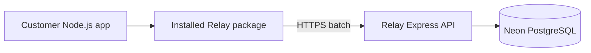

# Building the Node.js SDK

Status: proposed implementation plan and source research. This does not approve a public SDK contract or change the [recording requirements](spec.md). The [architecture](architecture.md#1-sending-events-from-the-sdk) owns proposed delivery guarantees and remaining decisions.

## What an SDK actually is

The SDK is a library installed inside a customer's application. It runs in that application's Node.js process; it does not need a server of its own. Its job is to turn a convenient function call into a validated HTTP request to Relay.



We write TypeScript source, build JavaScript plus type declarations, package those files, and publish the package to npm. Customers install it using npm, pnpm, or another compatible package manager. Type declarations give TypeScript customers completion and compile-time checks; JavaScript customers use the same executable files. See [TypeScript's publishing guide](https://www.typescriptlang.org/docs/handbook/declaration-files/publishing.html).

## Repositories worth studying

These are established, relevant official SDKs, not a comprehensive popularity ranking. GitHub displayed approximately 11.2k stars for OpenAI, 8.8k for Sentry, 633 for PostHog's JavaScript repository, and 479 for Segment's analytics-next repository when checked on 11 October 2026. Stars describe these repositories, not npm adoption or SDK quality.

| Source | What the source demonstrates | What Relay should learn |
| --- | --- | --- |
| [PostHog Node package](https://github.com/PostHog/posthog-js/tree/main/packages/node) | [Package manifest](https://github.com/PostHog/posthog-js/blob/main/packages/node/package.json) includes built JavaScript, declarations, and conditional import/require exports. [Node documentation](https://posthog.com/docs/libraries/node) describes bounded queues, batches, retries, and shutdown. | Closest model for transporting recorded events. Keep lifecycle explicit. |
| [Sentry JavaScript](https://github.com/getsentry/sentry-javascript) | [Core transport](https://github.com/getsentry/sentry-javascript/blob/develop/packages/core/src/transports/base.ts) limits its promise buffer, drains it for flush, and records queue overflow and network loss. | Bound outstanding work and make delivery failure visible. Its event-dropping policy is not automatically Relay's policy. |
| [Segment analytics-next](https://github.com/segmentio/analytics-next) | [Node client](https://github.com/segmentio/analytics-next/blob/master/packages/node/src/app/analytics-node.ts) distinguishes event capture, flush, and closing the client; it tracks pending events. | Queuing and successful delivery are separate states. Shutdown needs a defined endpoint. |
| [OpenAI Node](https://github.com/openai/openai-node) | [Configuration documentation](https://github.com/openai/openai-node/blob/main/docs/configuration.md) exposes typed errors, request timeouts, configurable retries, and custom fetch. [Manifest](https://github.com/openai/openai-node/blob/main/package.json) exports JavaScript for import and require. | Present a small typed interface with useful errors. This is an API client, so its request semantics are not a telemetry contract to copy. |

PostHog is the strongest starting reference for Relay's delivery layer. Copy principles rather than its feature flags, framework integrations, release tooling, or entire architecture.

## Package boundaries here

Keep the SDK in the current pnpm/Turborepo repository. Recommend this minimum layout:

```text
packages/sdk/
  package.json
  tsconfig.json
  src/index.ts       public exports
  src/client.ts      client lifecycle and recording
  src/transport.ts   HTTP delivery
  src/errors.ts      specific public errors
packages/contracts/ shared versioned event validation
```

Split buffering into another module only when the implementation needs it. The SDK must not import Express, Drizzle, Neon, backend environment configuration, or database credentials. It depends on the ingestion HTTP contract, not API implementation details. Customers supply a Relay ingestion credential and endpoint; their provider credentials stay outside Relay.

Shared contracts require care: a customer installing the SDK cannot resolve an unpublished workspace-only package. Recommend bundling the small contract module into the SDK's distributable when using a bundler, or publishing it as a real dependency when building with plain TypeScript. Choose one before publishing. Keeping equivalent validators independently copied into API and SDK risks drift.

## Building and distributing it

Start with ESM and `tsc` to emit JavaScript and `.d.ts` files into `dist`. Set explicit package exports, `types`, a `files` allowlist, and a supported Node engine range. [Node's package documentation](https://nodejs.org/api/packages.html) explains exports and module formats; [npm's manifest reference](https://docs.npmjs.com/cli/v11/configuring-npm/package-json/) explains package contents and engines. The repository currently requires Node 24 or later; the SDK's customer runtime minimum is a separate decision and must match what we verify. Do not claim browser or edge support initially.

Both import and require are common in the reference packages, but dual-format output introduces extra build and declaration work. Add CommonJS only when required by customers. Use a bundler then if it materially simplifies dual output or bundled contracts; it is unnecessary for a simple ESM-only package.

Use `workspace:*` to consume the SDK in a local example. Before release, run `npm pack --dry-run` to inspect the file list, then `npm pack` to produce an archive and install it into a separate temporary Node project. This catches unpublished dependencies and incorrect exports that workspace imports can hide. These commands package the release; pnpm remains our workspace manager. See [npm pack](https://docs.npmjs.com/cli/v11/commands/npm-pack/). Publish only after choosing an available npm name, access settings, and release version, following [npm's scoped-package guide](https://docs.npmjs.com/creating-and-publishing-scoped-public-packages/). Publication is a later action, not part of scaffolding.

## Implementation order

1. Finalize the versioned event/batch and acknowledgement schemas. Set concrete limits and public error/diagnostic types; record significant delivery decisions as the architecture requires.
2. Implement authenticated ingestion and Neon persistence through `packages/db`, following the [backend-first milestones](../../architecture/README.md#backend-first-milestones) and [schema proposal](../../architecture/database-schema.md). The current health endpoint cannot prove event recording.
3. Implement manual recording and explicit flush against that endpoint. Keep normalization and validation pure; isolate network calls and client-owned queue state.
4. Add bounded batching, retry scheduling, and shutdown using the owning architecture rules. Preserve event identity throughout delivery.
5. Run an external-package smoke exercise against the API/database: saved event, repeated ID, rejected credentials/input, and delivery failure. No test folder is needed for this exercise.
6. Add one explicit provider integration after manual delivery works. Keep provider results and telemetry diagnostics separate as [specified](spec.md#what-happens-during-a-call).

The first reviewable outcome is a packaged library installed in another Node.js app that submits an event and confirms persistence through the API. Provider automation and public npm release follow that proof.
