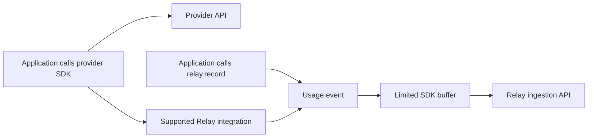
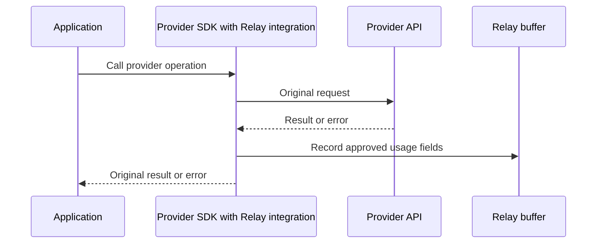

# Recording usage events

Status: draft. This document describes what the SDK records and how it behaves. [Architecture](architecture.md) describes what Relay does after receiving events; [the product specification](../../specification.md) defines overall scope.

## The basic flow

Applications keep their provider SDKs. They record usage through `relay.record(...)` or a supported provider integration. Both produce the same event format.



Manual recording works with any service. Automatic recording only works with integrations we explicitly support. Installing Relay alone does not discover every service.

## Where the data comes from

| Source | What it knows |
| --- | --- |
| HTTP transport | Destination, method, status, timing, network failures |
| Provider SDK/response | Operation, model, usage quantities, provider errors, request ID |
| Application configuration | Environment, safe key label, relevant application context |

An HTTP hook might see `POST api.provider.com`, `200`, and `820ms`. It cannot reliably infer the operation, model, input tokens, or `openai-production` key label.

Generic transport instrumentation may be added later. It must not invent provider operations, units, models, key identities, or costs.

## Setting up the client

These examples show intended interaction, not settled public methods or return types.

```typescript
const relay = createRelay({
  credential: process.env.RELAY_KEY,
  environment: "production",
});
```

The Relay credential determines the project. Event fields cannot override it. Client settings may include environment, safe default key labels, and SDK configuration. Actual provider secrets must not be required for attribution.

### Manual recording

```typescript
relay.record({
  provider: "custom-service",
  operation: "documents.convert",
  apiKeyId: "converter-production",
  outcome: "success",
  usage: [{ metric: "pages", unit: "page", quantity: "12" }],
});
```

The application supplies information Relay cannot observe. Unsupported providers must still be able to submit events.

### Supported integration

```typescript
const openai = relay.integrate("openai", {
  client,
  apiKeyId: "openai-production",
});
```

An integration may use middleware, hooks, custom transports/fetch, client wrappers, or supported SDK extension points. Provider calls remain direct; a Relay-hosted proxy is not required.

Prefer explicitly integrating a selected client over process-wide discovery. This makes coverage and key attribution clearer, limits interference with other traffic, and makes extraction/testing easier. Universal discovery is not required initially.

## What happens during a call



The application receives the provider's successful result or original error behavior. Relay must preserve that behavior as closely as possible.

“Email sent successfully, Relay upload failed” must not become an apparent email failure that encourages sending it again. Report recording/upload failures separately through diagnostics, a callback, or flush errors. The final reporting interface still needs to be chosen.

## One call, one event

One logical provider invocation has one recording owner. A provider adapter and transport hook must not independently count it twice. Lower-level observations can add fields to the same event; separately recorded metrics must be deliberately distinct.

```text
One OpenAI call → one usage event → counted once
```

Initially count logical SDK invocations. If the provider SDK retries HTTP internally and eventually succeeds, that remains one logical-call event. Physical attempts may be added as separate information later, with clear dashboard labels.

## Event contents

All capture paths produce this conceptual structure:

```typescript
type UsageEvent = {
  id: string;
  provider: string;
  operation: string;
  environment?: string;
  apiKeyId?: string;
  outcome: "success" | "error";
  statusCode?: number;
  startedAt: string;
  durationMs?: number;
  usage?: UsageMeasurement[];
  providerRequestId?: string;
  // Only approved provider fields; the final schema must validate them.
  metadata?: Record<string, unknown>;
};

type UsageMeasurement = {
  metric: string;
  unit: string;
  quantity: string;
};
```

This is a design sketch, not the final HTTP contract. The architecture may refine it. Events must support usage totals, pricing, errors, filtering, and rules.

| Example | Measurements |
| --- | --- |
| AI | 1,200 input tokens and 400 output tokens |
| Messaging | 1 message |
| Document processing | 12 pages |
| Storage | 500 MB, with billing details needed before calculating cost |

Keep measurements separate. The core model must not assume every provider uses the same unit.

Approved provider fields may include model, request ID, region, response classification, and error code. Capture only information needed for usage/cost/errors/attribution/alerts. Do not collect provider secrets, authorization headers, passwords, full request/response bodies, arbitrary application data, or unnecessary personal information.

Use explicit key labels such as `openai-production`, `openai-staging`, or `stripe-prod`, configured once per client. Initial versions must not hash/fingerprint provider credentials to create labels.

## Event IDs and retries

Every event has a stable ID. Retrying delivery keeps it.

| Situation | What gets recorded |
| --- | --- |
| Provider SDK retries internally, then succeeds | One logical invocation |
| Relay upload times out and is retried | Same event and ID |
| Application makes a new provider call | New event |

```text
evt_123 → upload timeout → retry evt_123 → count once
```

Backend duplicate handling must prevent repeated delivery from adding usage/cost again. Provider retries and telemetry retries must not be confused.

## Streams

Receiving headers does not mean a streaming operation finished.

```text
Start → consume chunks → final usage becomes available → stream completes
                                                     → finalize event
```

Preserve streaming, iteration, cancellation, and backpressure where possible. Do not buffer the whole stream solely for telemetry.

A stream may fail, be cancelled, stop early, or finish without final usage. Keep available provider/operation/outcome/duration/error details, but leave missing usage unknown. Do not fabricate measurements.

## Sending events to Relay

Use limited in-memory buffering and asynchronous batches so provider calls do not wait unnecessarily for uploads.

The buffer must not grow without limit during a Relay outage. Capacity and full-buffer behavior must be explicit. Possible choices include rejecting new events, dropping older events with reporting, or limited waiting. [The architecture](architecture.md#1-sending-events-from-the-sdk) recommends a policy without treating it as approved.

Applications can call `await relay.flush()` before controlled shutdown, serverless completion, or test completion. Its exact waiting/timeout/error behavior belongs in the architecture and SDK contract.

An event kept only in memory can be lost if the process crashes. Do not advertise lossless SDK capture without stronger storage.

## Cost and errors

Capture accurate measurements first. The SDK does not need to determine every event's final monetary cost.

```text
1,200 input tokens + 400 output tokens + model
    → Relay applies supported pricing
    → estimated cost, or unknown if information is missing
```

Pricing belongs in the backend so price changes do not require SDK updates. Preserve enough approved usage dimensions for supported calculations. Unknown cost does not make a valid usage event invalid.

Keep provider success/failure, provider-reported errors, transport/network failures, and Relay delivery failures separate. Upload failures must never increase the external provider's error rate.

## Initial scope

The first version supports manual recording, one explicit integration, a common event format, safe key labels, stable IDs, limited asynchronous buffering, flush, and ingestion.

It does not require universal discovery, arbitrary monkey-patching/global HTTP interception, distributed tracing, APM, full payload logging/inspection, secret fingerprinting, physical-attempt accounting, guaranteed lossless capture, or provider-side proxying. Multiple integrations are not required initially.

## Backend requirements

All capture paths use one backend processing path. It must:

- Save valid events even when pricing is unavailable.
- Show whether cost was supplied or calculated and which prices were used.
- Avoid counting repeated delivery twice.
- Use matching event/time/usage/cost/error definitions for dashboard totals and rules.

[The architecture document](architecture.md) covers transport, authentication, validation, duplicate handling, persistence/retention, synchronous/background work, normalization, pricing/versioning, summaries, windows, rules, alerts, webhooks, retries, concurrency, guarantees, failures, and Relay's own operational signals.

Compare alternatives for material decisions, recommend the simplest option for current requirements, explain trade-offs/limits, say when to revisit it, and identify needed ADRs. Consider PostgreSQL/SQL and saving events before replying before adding queues or specialized analytical storage. Processing stages do not imply separate services/databases/workers.

## Acceptance checks

- Any service can submit manually, and one provider can use a supported automatic integration.
- Both paths produce the same event format; backend work does not depend on how capture happened.
- One logical call cannot accidentally be counted twice; telemetry retries preserve its ID.
- Provider results/errors and streaming behavior remain intact.
- Unknown usage stays unknown; upload failures stay separate from provider failures.
- Key attribution does not require provider secrets, and captured fields are restricted.
- SDK memory is bounded, applications can flush, and delivery limits are stated honestly.
- Events contain enough information for usage, cost, errors, filtering, and rules.
