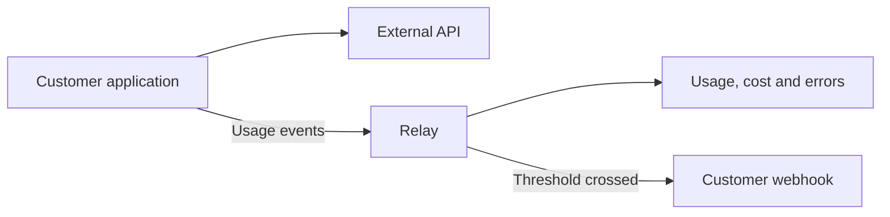

# Relay product specification

## What we are building

Relay helps developers, small engineering teams, and product teams see how their applications consume external services.

| Question | Example |
| --- | --- |
| Usage | How many calls did production make to OpenAI this week? |
| Cost | Which application and key label contributed most to spending? |
| Errors | What percentage of calls to our email provider failed? |
| Alerts | Has spending crossed the configured budget? |

Teams should answer these questions in one place instead of combining separate provider dashboards.



Applications keep calling providers directly. Relay receives structured events through its server-side JavaScript/TypeScript SDK or HTTP API.

## Users and scope

Users include individual developers using several services, small teams running multiple applications/environments/credentials, product teams reviewing consumption cost, and backend/platform engineers needing threshold notifications.

Relay tracks external API/service consumption. It supports authenticated event submission, validation, storage, summaries, time filtering, project/environment/provider/key breakdowns, simple rules, alerts, outgoing webhooks, retries, and delivery history.

Events may contain provider, operation/endpoint, time, project association, environment, safe key label, success/error, status code, usage quantities, cost, and a small set of approved provider fields.

Every proposed feature should answer: **Does this help users understand or act on external API usage, cost, or errors?**

### Outside the scope

Do not add these without intentionally changing this specification:

- CPU, memory, host, container, Kubernetes, or network monitoring.
- Distributed/internal tracing, generic APM, uptime monitoring, exception aggregation, or stack-trace analysis.
- Arbitrary metrics, application log search, or general-purpose log storage.
- Incident management, pager/on-call systems, infrastructure topology discovery, or ML-based anomaly detection.
- Renewal tracking/reminders, automatic renewals/payments, subscription management, fixed recurring fee accounting, or provider invoice reconciliation.

## Projects, environments, and key labels

A project groups usage for an application such as FormSpace or Internal AI Tool. It owns its ingestion key, environments, events, rules, webhook endpoints, and alerts.

Every project-scoped operation must check access. Data from one project must never be accessible through another.

An event may identify an environment such as production, staging, or development. Key labels are safe names such as `openai-production` or `email-service-prod`; they are never the actual provider credentials.

For example: “What did FormSpace production spend on OpenAI over the last seven days, grouped by key label?”

## Recording events

Clients submit structured events, not arbitrary application logs. They keep their provider SDKs; Relay provides manual recording and selected automatic integrations.

[The event-recording specification](features/event-recording/spec.md) owns the conceptual event format and capture behavior. Examples are design sketches, not a final HTTP contract or database schema.

The ingestion endpoint is conceptually:

```http
POST /v1/events
Authorization: Bearer <relay-ingestion-credential>
Content-Type: application/json
```

The credential determines the project. Ingestion must authenticate, validate, reject malformed input, handle retries safely, and limit abuse. Expensive summaries must not unnecessarily delay requests. The architecture chooses the implementation.

### Repeated events must not inflate totals

```text
One event costs $10
    → the application retries uploading it
    → Relay still counts $10, not $20
```

Define duplicate handling explicitly, including retries, timeouts, repeated delivery, and repeated processing. The event-recording feature requires stable IDs and no duplicate accounting; the architecture specifies how.

## Usage and cost

The core model must work across providers. Common fields should stay independent of any one provider; limited provider details can be approved metadata.

| Service | Example measurements |
| --- | --- |
| AI | Input/output tokens, model |
| Messaging | Messages, message type, region |
| Document processing | Pages |

Keep units alongside quantities. Tokens and messages cannot be added into one meaningful usage total. Event count is separate.

Cost means usage-based consumption cost. Clients may report it, or Relay may estimate it using supported provider prices and usage. Token pricing may depend on model, input/output rates, and cached-token details.

Every cost identifies currency and whether it was reported or estimated. Missing cost means unknown, not zero. Summaries must show incomplete cost data.

Users can choose a reporting currency. Preserve original amounts/currencies. Showing USD costs in INR requires conversion, not a changed symbol. Supported currencies, rate sources, and conversion dates remain open.

Label calculated cost as an estimate, not a verified provider bill. Unknown providers can submit valid events even if Relay cannot price them.

## Dashboard and time filtering

The primary dashboard shows event count, known cost, errors, and error rate.

Eventually support breakdowns by provider, project, environment, key label, operation, time range, and status. The MVP subset appears below.

Charts should answer calls per minute/hour/day, errors over time, and cost per hour/day. Keep results correct as volume grows; storage/query improvements are architecture decisions based on measured needs.

## Rules and alerts

Start with a limited set of simple rules, not a general-purpose query language.

Examples:

- Daily provider cost greater than $20.
- Provider calls greater than 10,000/hour.
- Provider error rate greater than 5%.
- Key-label calls greater than 1,000/minute.

A rule specifies metric, scope, comparison, threshold, and window. For example: cost, provider OpenAI, greater than 20 USD, last 24 hours. A calendar day and the last 24 hours are different; the chosen behavior must be explicit.

When a rule becomes triggered, create an alert with its rule, project, provider/key/environment scope, threshold, observed value, and time window. Avoid uncontrolled repeated alerts for the same persistent condition. Reset, duplicate-alert, and cooldown behavior must be designed explicitly.

## Webhooks

Users register an HTTP endpoint such as `https://customer.example/api/usage-alerts`.

A conceptual alert payload contains an event ID, type, creation time, project/provider scope, observed value, threshold, and window. Choose and version the final external contract deliberately.

Delivery should eventually support asynchronous sending, timeouts, bounded retries/backoff, stored attempts, a final failure state, manual replay, and delivery history.

Retrying the same alert preserves its webhook event ID. Customers must tolerate duplicates; external HTTP calls cannot promise exactly-once customer execution.

Sign requests so recipients can verify them. The reviewed security design must cover forged requests, replay, payload integrity, secret storage, and rotation. A typical construction is HMAC over timestamp and payload.

Check user-configured destinations before production. Block localhost, loopback/private ranges, cloud metadata addresses, and redirects into restricted destinations. Document these protections in an architecture/security decision.

## Authentication, privacy, and records

User login, project access, ingestion credentials, and webhook signing secrets serve different purposes and must stay separate.

Each project can have only one active ingestion key. It does not expire automatically. Users can revoke it or regenerate a replacement. Regeneration invalidates the previous credential; revoked credentials cannot be reactivated.

Collect only information needed for consumption analysis. Discourage or prevent provider credentials, authorization headers, passwords, sensitive request/response content, and unnecessary personal data. Never log secrets.

The main records are users, projects, environments, ingestion credentials, usage events, rules, alerts, webhook endpoints, deliveries, and attempts. Implementation tables may differ.

## Initial MVP

1. User login, project creation, and ingestion credential generation.
2. Structured event ingestion and persistent storage.
3. Server-side JavaScript/TypeScript SDK.
4. Dashboard event count, known cost, errors, and error rate.
5. Provider and key-label breakdowns, with basic time filtering.
6. One simple threshold rule type and alert creation.
7. Webhook registration, delivery, and attempt history.

Anything beyond this needs explicit justification. The recording feature adds its specific capture requirements.

The MVP does not require Kafka, Kubernetes, microservices, distributed databases, Redis, ClickHouse, Elasticsearch, ML/anomaly detection, complex rules, real-time UI streaming, multi-region infrastructure, or advanced RBAC. A broad suite of provider SDK wrappers is not required; the recording feature calls for one integration initially. These technologies are not forbidden, but must solve a demonstrated problem.

## How we build and verify it

Start with the simplest correct implementation. Measure it, identify a concrete limitation, consider alternatives, record significant decisions, and measure again.

Prioritize duplicate handling, cost accounting, concurrent writes, correct summaries, repeated rule checks/alerts, and webhook retries. State limits when a stronger guarantee would be impractical.

Test duplicates, ingestion timeout, database failure, worker termination, slow/5xx/timeout webhook responses, malformed URLs, simultaneous processing, and traffic spikes. Failure behavior should be demonstrated, not only documented.

The project offers practice with indexing, transactions, time queries, aggregation, retries, idempotency, authorization, HMAC, SSRF, rate limits, worker recovery, batching, concurrency, connection use, and backpressure. Queues, rollups, partitioning, and other techniques should appear only when needed.

This specification does not select database/queue/cache technology, deployment layout, service count, frameworks, worker technology, or aggregation mechanism. Those choices belong in architecture documents and ADRs.

Update this document when purpose, scope, user-visible behavior, core records, external guarantees, privacy/security requirements, or MVP boundaries change. Implementation changes preserving those requirements usually do not require product-specification changes.

## What success looks like

A real application submits events; Relay saves them, shows useful summaries, checks a rule, creates an alert, and attempts reliable webhook delivery.

We should be able to explain why each major part exists, what it guarantees, how it fails, what alternatives were considered, where measured limits exist, and what assumptions the implementation makes.
